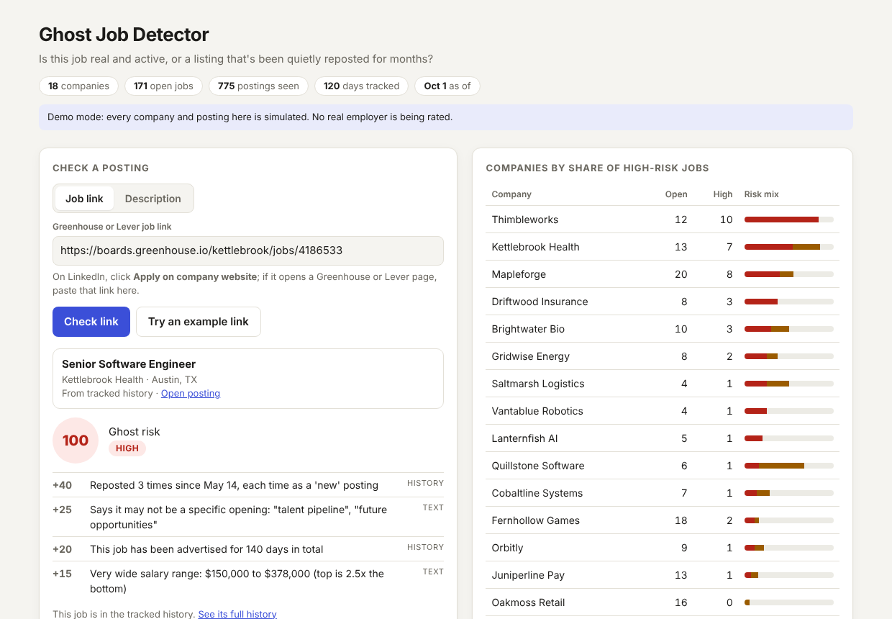
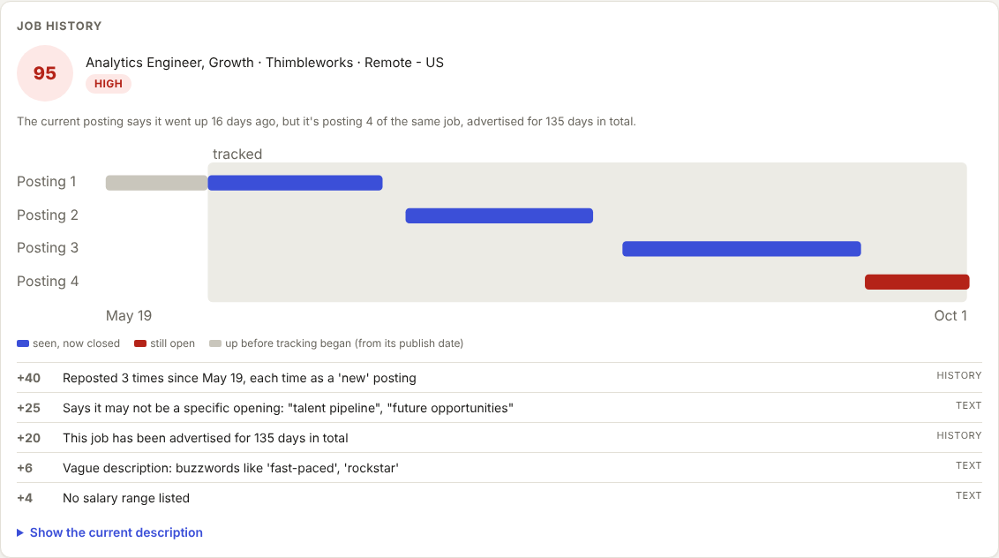

# Ghost Job Detector

**Is this job real and active, or a listing that's been quietly reposted for months?**

Ghost jobs are postings that stay up with no real intent to hire. A common pattern:
the company closes the listing and reposts it every few weeks with small edits. Each
repost gets a new ID and a fresh "posted 3 days ago" date, so a job seeker can't
tell that the same job has been advertised since spring.

This project tracks company job boards daily, stitches reposts back together into a
single **job history**, and gives each open job an explainable 0–100 ghost-risk score.



**Zero dependencies.** Plain Python 3.10+ standard library: no `pip install`, no API keys.
MinHash and LSH are implemented from scratch.

---

## Quick start

```bash
python -m ghostjobs simulate          # 120 days of simulated job boards -> data/demo
python -m ghostjobs serve             # open http://127.0.0.1:8000
```

From the terminal:

```bash
python -m ghostjobs report                       # riskiest open jobs, with reasons
python -m ghostjobs check https://boards.greenhouse.io/<company>/jobs/<id>
python -m ghostjobs check posting.txt --title "Software Engineer"
python -m ghostjobs eval                         # accuracy vs ground truth and baselines
python -m pytest                                 # 63 tests (needs pytest)
```

All demo companies are fictional. Real employers are never labeled, even in a demo.

---

## How it works

```
company job boards (Greenhouse / Lever public feeds)
   │  1. collect     one raw snapshot per board per day (gzipped JSON)
   ▼  2. ingest      SQLite: postings, first/last seen, which days each board was observed
   ▼  3. link        MinHash + LSH find near-duplicate postings -> job histories
   ▼  4. score       explainable points: reposts, true age, salary range, wording
   ▼  5. show        web app, CLI, "paste a posting" checker
```

### 1. Collecting and storing (`collect.py`, `store.py`)

- Fetches public board feeds once a day, with retries and exponential backoff for rate
  limits (429) and server errors, fail-fast on 404, and a polite delay between requests.
- Stores **raw** responses, so a parsing bug can be fixed and everything re-ingested without losing history.
- Snapshot writes are atomic (write to a temp file, then rename), so a crash never leaves a half-written file.
- **Missed days aren't closures.** If the collector fails one day, every posting is absent
  from that day's data. The store records which days each board was actually observed, and
  openness is judged against that. Without this, one outage would invent fake reposts.
- Ingestion is incremental: re-running only reads new snapshots.

### 2. Linking reposts: MinHash + LSH (`minhash.py`, `lineage.py`)

Reposts are *edited*, so exact matching fails (it recovers under 5% of repost links). Comparing
every pair of postings is O(n²). The standard solution, implemented from scratch:

- **Shingles:** each posting becomes a set of overlapping 3-word phrases.
- **MinHash:** for a random hash function, the chance two sets share the same minimum hash
  equals their Jaccard similarity. 64 hash functions give a 64-number signature whose
  agreement rate estimates similarity.
- **LSH banding:** the signature is split into 16 bands of 4. Postings sharing any band
  become candidates: P(candidate) = 1 − (1 − s⁴)¹⁶, an S-curve that catches near-duplicates
  and almost never pairs unrelated postings. Buckets are scoped per company.
- **Verification:** candidates must have exact Jaccard ≥ 0.62 *and* similar titles, then
  merge with union-find. Signatures are cached in SQLite, so rebuilding is fast.
- **Bulk hiring isn't reposting:** a linked group is split by location. The same role posted in
  five cities at once becomes five histories that are flagged as concurrent, not as reposts.
- **Repost vs. duplicate:** a posting that appears around or after the previous one closed is a
  repost; one that overlaps it is a parallel opening.

#### Choosing the threshold from data

On simulated data, reposts of the same job were ≥ 0.62 similar, while different jobs at the same
company rarely exceeded that. Shared company boilerplate ("About us", benefits) is what makes
different jobs look alike, so I tested ways to reduce it:

| Shingling approach | Linking errors at best threshold |
|---|---|
| **3-word windows across the whole text (used)** | **4** |
| Same, with company boilerplate removed | 6 – 12 |
| Windows within each line only | 13 – 44 |
| Lines sorted first (order-independent) | 16+ |

The simplest approach won. **Known weakness:** in a very short posting, heavily reordering bullets
breaks a large share of the phrases that span two bullets, which can push a real repost under
the threshold. My first unit test caught this.

### 3. Scoring (`score.py`)

Each signal adds points and a sentence explaining why; the score is the sum (max 100).
**High** ≥ 55, **medium** ≥ 30.

| Signal | Points |
|---|---|
| Reposted 1 / 2 / 3+ times | 12 / 28 / 40+ |
| Same job advertised 45+ / 90+ / 180+ days in total | 10 / 20 / 30 |
| Says it may not be a real opening ("talent pipeline", "future opportunities") | 25 |
| Salary range top ≥ 2× bottom (≥ 1.6× for 8) | 15 |
| Vague description (buzzwords, few concrete details) | 6 – 12 |
| Very short description | 5 |
| No salary listed | 4 |
| Posted in 5+ locations at once | 5 |

The weights are hand-set from how hiring works, not fitted, so every point can be explained.
With labeled real data, they could be learned with logistic regression.



### 4. Checking a single job: link or description

**Paste a Greenhouse or Lever job link** (`boards.greenhouse.io/<company>/jobs/<id>`,
`jobs.lever.co/<company>/<id>`, and their variants):

- If the job is already tracked, its stored copy is used, with full repost history.
- Otherwise that one job is fetched live from the board's public feed and scored on its text
  plus its own publish date ("the board says this has been up for 120 days").
- **The pasted URL is never fetched.** The app extracts the company and job ID, validates both
  against strict patterns, and builds the official API URL on a fixed host itself. A crafted
  link therefore can't make the server request an arbitrary address (server-side request forgery).
- Errors are specific: a removed job (404) says so; an unreachable board suggests pasting
  the description instead.

**LinkedIn links are deliberately not supported.** LinkedIn's terms prohibit automated access,
so the app explains that and suggests a way around it: many LinkedIn postings have an
*Apply on company website* button that leads to a Greenhouse or Lever page, and that link works.
Company sites that embed Greenhouse (`?gh_jid=`) don't reveal the board name, so those get a
clear message too.

**Paste a description** from anywhere: text signals are scored immediately, and if it matches
a tracked posting (via the same LSH index), that job's full history counts too.

---

## Results

`python -m ghostjobs eval`, on **5 random seeds that were never used during development**
(thresholds and weights were set on seed 42 only). Each run: 18 fictional companies, 120 days.

**Linking postings into job histories** (pairwise precision / recall)

| Method | Precision | Recall |
|---|---|---|
| Exact text match | 100% | 3 – 5% |
| Same title = same job | 67 – 79% | 76 – 83% |
| **MinHash + LSH (this project)** | **99.4 – 100%** | **100%** |

**Detecting ghost jobs among open jobs** (flag = high risk)

| Method | Precision | Recall | False alarms: genuine / legit repost / bulk |
|---|---|---|---|
| Posting is 60+ days old (all a job seeker sees) | 100% | 14 – 26% | 0% / 0% / 0% |
| Job history only | 100% | 47 – 70% | 0% / 0% / 0% |
| **Full score** | **98 – 100%** | **67 – 84%** | **0% / 0 – 9% / 0%** |
| Full score, but title-based linking | 96 – 100% | 46 – 67% | 0% / 0 – 9% / 0% |

What this shows:
- **Reposting hides ghost jobs.** The posting date catches at most a quarter of them; job history roughly triples that.
- **Linking quality matters downstream:** the same scoring with naive title linking misses far more ghosts.
- **The hard cases behave as expected.** Bulk hiring is never flagged. A real job reposted
  twice occasionally is (up to 9%), which is the honest ambiguity: from the outside it looks
  the same as a ghost job.
- About 20% of ghost jobs stay low or medium risk. These are mostly recent ghosts with
  concrete wording and no reposts yet; history needs time to accumulate.

**Caveat:** these numbers come from a simulation I designed. To keep it from being rigged,
signals overlap between classes (some real jobs have wide salary ranges or buzzwords; many
ghost jobs read as perfectly concrete), and the evaluation seeds were held out. Still, it shows
the method works as designed, not how often real companies post ghost jobs.

---

## Tracking real companies

```bash
cp boards.example.txt boards.txt     # then add boards, one per line
python -m ghostjobs collect          # run once a day (Task Scheduler / cron)
python -m ghostjobs serve --data data/real
```

Find a company's token in its job board URL: `boards.greenhouse.io/<token>` or
`jobs.lever.co/<token>`. History signals need a few weeks of daily snapshots to mean much.
The collector was tested against recorded-format fixtures; field names follow the public
Greenhouse and Lever board APIs, and parsing is defensive about optional fields.

---

## Project structure

```
ghostjobs/
  text.py       HTML to text, shingles, salary parsing, vagueness signals
  minhash.py    MinHash signatures and LSH banding (from scratch)
  sources.py    Greenhouse / Lever feed parsers -> one Posting shape
  links.py      job link parsing and safe API URL building
  collect.py    daily collector with retries, backoff, atomic writes
  store.py      SQLite: postings, sightings, observed days, signature cache
  lineage.py    near-duplicate linking -> job histories, repost counting
  score.py      explainable scoring; checking pasted postings
  simulate.py   realistic simulated boards + ground truth
  evaluate.py   accuracy vs ground truth, with baselines
  app.py        query layer shared by CLI and server
  server.py     JSON API + web page (stdlib http.server)
tests/          63 tests: parsing, MinHash, LSH, collector, links, linking, scoring, API
```
